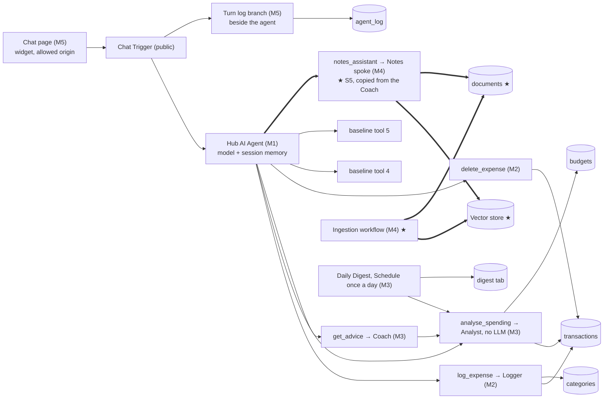

# PRD: Hub Agent and Merged Build (Member 1, Lead)

| | |
|---|---|
| **Project** | C389 CA2, Project 2: Personal Productivity Agent |
| **Scenario** | S5 Notes and Reading Assistant (pattern: a tool, with retrieval) |
| **Owner** | Member 1 (lead) |
| **Repo** | https://github.com/SoeSanWaing/C389_CA2_Team5 |
| **Status** | Draft v0.1, 17 Nov 2026 |
| **Hard deadline** | Merged on the nominated account **before Lesson 14**; final submission 23:59 on presentation day (Lesson 17 or 18) |

---

## 1. Purpose

The hub is the one entry point that holds everything together. It takes a chat message, keeps session memory, and picks one of **seven tools**: six finance tools from the baseline and one new S5 notes tool. This PRD covers:

1. The hub agent: model, session memory, the 7 tool connections, and the system message routing rules.
2. Merging every member's workflow onto the nominated account.
3. The interface contracts every spoke must follow so the merge works the first time.
4. Report sections 1.3, 2.1, 2.3 and the intro, architecture and wrap-up parts of the presentation.

### Out of scope (other members own these)
| Item | Owner |
|---|---|
| Logger, txn_id duplicate check, delete_expense spoke, `transactions` and `categories` tabs | Member 2 |
| Analyst (no LLM), Coach, Daily Digest, `budgets` tab | Member 3 |
| Vector store, embeddings, `documents` tab, ingestion, citation and refusal behaviour | Member 4 |
| Chat page, CORS origin, turn log branch, `agent_log` tab, repo hygiene | Member 5 |

The hub owner still **checks** that these pieces meet their contracts (Section 6) and plugs them into the hub.

---

## 2. Requirements from the brief (what the marker checks)

These are checked on the merged build, on the nominated account, at the demo.

| ID | Requirement | Source |
|---|---|---|
| R1 | One chat entry point with a model, memory keyed to the session, and a system prompt that **names every tool** | Brief §3, The Hub |
| R2 | System prompt **forbids guessing a date** and **forbids stating a number no tool returned** | Brief §3, The Hub |
| R3 | **At most seven tools** on the hub | Brief §7, The build |
| R4 | 7th tool covers S5 jobs through an `action` input; its description says **when finance is meant instead** | Brief §2, Hub tool |
| R5 | System message adds the new tool to the tool list plus **one rule** for when to call it rather than a finance tool | Brief §2, System message |
| R6 | Anything that deletes first names the one entry, then waits for the user to confirm | Brief §7, Destructive actions |
| R7 | The log branch sits **beside** the agent, never after it | Brief §7, The build |
| R8 | One message that uses finance and S5 in the same turn works (fee schedule answered beside spending figures) | Brief §3 |
| R9 | Finance keeps working after the extension (the eval set is run before and after) | Brief §2, §3 |
| R10 | Every workflow is exported as JSON from the nominated account and pushed to the repo; no keys or tokens anywhere | Brief §7 |

---

## 3. Users and key user stories

**User:** a student managing their own spending and their own notes and documents (made-up or personal data only).

| # | As a user I want to... | Tool(s) the hub should pick |
|---|---|---|
| U1 | "Spent $4.50 on chicken rice at lunch" → have it logged | `log_expense` |
| U2 | "How much did I spend on food this month vs budget?" | `analyse_spending` |
| U3 | "Any tips to cut my spending?" | `get_advice` (which uses Analyst figures only) |
| U4 | "Delete the Grab ride from yesterday" → it names the entry and asks first | `delete_expense` (find, then confirm) |
| U5 | "What does my notes say about the late payment fee?" → answer plus the document it came from | `notes_assistant` (action `ask`) |
| U6 | "What's the capital of France?" (not in docs) → plain "I couldn't find that in your documents" | `notes_assistant` → no match |
| U7 | "How much have I spent on school fees this month, and what does the fee schedule say is due next term?" | `analyse_spending` **and** `notes_assistant` in the same turn |
| U8 | "What did I just ask you?" | No tool, answered from session memory |

---

## 4. The hub design

### 4.1 Nodes (n8n)

| Node | Config |
|---|---|
| **Chat Trigger** | Public, hosted/embedded mode, allowed origin = Member 5's page URL (never `*`) |
| **AI Agent** | Tools Agent. System message from Section 5.2 |
| **Chat Model** | The class model credential on the nominated account. Low temperature (0–0.2) for stable routing |
| **Memory** | Window buffer memory, **session key = `{{ $json.sessionId }}` from the Chat Trigger**, window around 10 turns |
| **Tools (7)** | Call-workflow tools, one per spoke (Section 4.2) |
| **Turn log branch** | Second output from the Chat Trigger, running in parallel to the agent → `agent_log` (Member 5 builds it, Member 1 wires it beside the agent) |

### 4.2 The seven tools

> ⚠️ Tools 4 and 5 must match the exact baseline names from Lessons 11–12. Check them against your own Lesson 11 workflow and rename the rows below before the system prompt is finalised.

| # | Tool name | Spoke workflow | Owner | Inputs |
|---|---|---|---|---|
| 1 | `log_expense` | Logger | M2 | `description`, `amount`, `category`, `date` (date comes from the date tool, never guessed) |
| 2 | `analyse_spending` | Analyst (code only) | M3 | `month` (YYYY-MM), optional `category` |
| 3 | `get_advice` | Coach | M3 | `question` |
| 4 | *(baseline tool 4, e.g. `get_today`)* | Date/time helper | baseline | — |
| 5 | *(baseline tool 5, e.g. `get_digest`)* | Digest reader | baseline | `date` |
| 6 | `delete_expense` | Delete Expense | M2 | `action` (`find` \| `confirm`), `query`, `txn_id` |
| 7 | `notes_assistant` **(new, S5)** | Notes spoke (copied from the Coach) | M4 | `action` (`ask` \| `list`), `question`, optional `doc_title` |

**Design choice: `notes_assistant` has no `add` action in chat.** Documents go in through Member 4's ingestion workflow, not through chat. This keeps the hub at 7 tools and avoids storing documents typed in chat that we can't check. If the team wants `add`, it goes through the same `action` input and doesn't need an 8th tool.

---

## 5. Guardrails, tool description and system message

Use these as the **working build text**. Sections 2.3 and 1.3 of the report must paste what is actually in the final build, word for word. Rewrite and tune these during testing, and write the report prose in your own words (brief §7).

### 5.1 Guardrails (feeds report 1.3)

| Rule | Exact condition or wording |
|---|---|
| G1 Route to notes | Call `notes_assistant` when the message asks what a stored document, note, reading or fee schedule **says**. Call a finance tool when the message asks what the user **spent, logged, budgeted** or wants to delete. |
| G2 Both in one turn | If a message asks for both a spending figure and a document fact, call the finance tool **and** `notes_assistant`, then answer each part with its own source. |
| G3 No guessed numbers | Never state an amount, total, count or percentage that a tool did not return in this turn or earlier in the session. |
| G4 No guessed dates | Never guess today's date. Get it from the date tool. If the user gives a relative date ("yesterday"), work it out from the tool's date. |
| G5 Cite or refuse | Every notes answer names the document title it came from. If `notes_assistant` returns `matched: false`, reply exactly: *"I couldn't find that in your stored documents."* Do not fall back to general knowledge. |
| G6 Confirm before delete | `delete_expense` is called with `action: find` first. The hub repeats the one entry (date, description, amount, txn_id) and asks "Delete this entry? (yes/no)". Only an explicit yes in the **next** user turn leads to `action: confirm`. More than one match → ask which one and delete nothing. |
| G7 Refuse unreadable logs | If the amount is missing or unreadable, don't log. Ask for the amount. |
| G8 No tool needed | Greetings, thanks and questions about the conversation are answered without calling a tool. |
| G9 Out of scope | Requests no tool can do (e.g. "book me a flight") get a plain refusal that lists what the assistant can do. |

### 5.2 System message (feeds report 2.3)

```text
You are a personal productivity assistant for one user. You handle two areas:
(1) their spending, stored in a Google Sheet, and (2) their own stored documents
and notes.

TOOLS
- log_expense: record one expense from the user's sentence.
- analyse_spending: totals per category against budget for a month. Use for any
  question about how much was spent or how much budget is left.
- get_advice: short spending advice based only on analyse_spending figures.
- <baseline tool 4>: returns today's date. Use it whenever a date is needed.
- <baseline tool 5>: <one-line description from the baseline>.
- delete_expense: find one expense (action "find"), then delete it (action
  "confirm") only after the user says yes to that exact entry.
- notes_assistant: answer questions using ONLY the user's stored documents
  (action "ask"), or list stored documents (action "list").

RULES
1. Use notes_assistant when the user asks what a document, note, reading or fee
   schedule says. Use the finance tools when the user asks what they spent,
   logged or budgeted, or wants to log or delete an expense. If a message asks
   for both, call both and answer each part.
2. Never state a number that a tool did not return.
3. Never guess a date. Call <baseline tool 4> to get today's date.
4. For notes answers, always name the source document. If notes_assistant finds
   no match, say: "I couldn't find that in your stored documents." Do not use
   general knowledge instead.
5. Before deleting, show the one entry found and ask the user to confirm. Only
   delete after a clear yes. If several entries match, ask which one.
6. If an amount is missing or unreadable, do not log it. Ask for it.
7. Do not call a tool for greetings, thanks or questions about this chat.
8. If no tool can do what is asked, say so plainly and list what you can do.
Keep replies short: two to four sentences unless the user asks for detail.
```

### 5.3 `notes_assistant` tool description (feeds report 2.3)

```text
Answers questions using only the user's stored documents (notes, readings, fee
schedules) and says which document each answer came from. action "ask" needs
"question"; action "list" returns the stored document titles. Returns
matched=false when nothing relevant is found. Do NOT use this for the user's own
spending, totals, budgets, logging or deleting expenses: use the finance tools
for those.
```

---

## 6. Interface contracts (every spoke must meet these before merge)

The hub relies on these shapes. Any change has to be agreed in the group chat **before** it is built.

| Spoke | Trigger input (JSON) | Output the hub expects |
|---|---|---|
| Logger | `{ description, amount, category, date }` | `{ status: "logged" \| "duplicate" \| "refused", txn_id, reason }` |
| Analyst | `{ month, category? }` | `{ month, totals: [{category, spent, budget, remaining}], skipped_repeats, skipped_unreadable }` |
| Coach | `{ question }` | `{ advice }` (2–3 sentences, Analyst figures only) |
| Delete Expense | `{ action: "find" \| "confirm", query?, txn_id? }` | find → `{ matches: [{txn_id, date, description, amount}] }`; confirm → `{ deleted: true, txn_id }` |
| Notes | `{ action: "ask" \| "list", question?, doc_title? }` | `{ matched: bool, answer, sources: [doc_title] }` or `{ documents: [title] }` |

Rules for every spoke:
- Return a **single object** with a plain text summary field if needed. No raw sheet dumps.
- Never return a credential or key in output.
- Sheet tab names are fixed: `transactions`, `categories`, `budgets`, `documents`, `agent_log` (+ the digest tab from the baseline). **Nothing in the finance tabs is renamed.**

---

## 7. Architecture (feeds report 2.1)



★ marks S5 parts. In the report, redraw it in draw.io/Figma with the same boxes and mark the S5 parts in one colour.

---

## 8. Merge plan

**Nominated account:** a member who will definitely be at the demo. Decide by **[date]** and record it here: `________`.

| Step | Action | Done when |
|---|---|---|
| M1 | Each member exports their workflow(s) as JSON and pushes to `workflows/<member>/` on a branch | JSON in repo, no credentials inside (search for `apiKey`, `token`, `Bearer`) |
| M2 | Import into the nominated account in this order: spokes first (Logger, Delete, Analyst, Coach, Digest, Notes, Ingestion), then the turn log, then the hub | All workflows show in the account |
| M3 | Re-link credentials on every node (Google Sheets OAuth, model, embeddings) to the nominated account's own | No node shows a red credential warning |
| M4 | Point every Sheets node at the **one** team spreadsheet; check tab names | Each spoke runs once by itself with test input |
| M5 | Re-select the sub-workflow in each of the 7 hub tool nodes (IDs change on import) | Hub execution shows each tool succeeding |
| M6 | Activate: hub, digest schedule (once a day), chat trigger public; set allowed origin to the page URL | Page answers a message |
| M7 | Run the fixed eval set, record **before** results (finance only, tool 7 disconnected) | Results saved in `eval/` |
| M8 | Connect tool 7, run the eval set plus the 3–5 S5 messages, record **after** results | Results saved in `eval/` |
| M9 | Export all final workflows from the nominated account and replace the JSON in `workflows/final/` | Repo matches the demo build |

### Proposed repo layout (agree with M5, who owns repo hygiene)
```
/workflows/final/        exported JSON of the merged build (submitted)
/workflows/<member>/     working exports before merge
/site/                   chat page (index.html)
/docs/                   this PRD, architecture diagram, guardrails
/eval/                   eval set, expected tools, before/after results
README.md                setup steps, credential NAMES only, nominated account role
.gitignore               .env, *.credentials.json
```

---

## 9. Acceptance criteria (hub)

| # | Test (sent from the page, tools read from the execution, not the reply) | Pass if |
|---|---|---|
| A1 | "Spent $12 on Grab to school" | Only `log_expense` called; row in `transactions` |
| A2 | "How much did I spend on transport this month?" | `analyse_spending` called; reply number equals the tool output |
| A3 | "What does the fee schedule say about late fees?" | Only `notes_assistant` called; reply names the document |
| A4 | "What is the boiling point of mercury?" | `notes_assistant` returns no match; reply uses the exact refusal wording |
| A5 | U7 combined message | Both `analyse_spending` and `notes_assistant` in one execution |
| A6 | "Delete my Grab ride" | `delete_expense` `find` only; nothing deleted until "yes" next turn |
| A7 | "Hi, thanks!" | No tool called |
| A8 | Second message in a session refers to the first ("and for food?") | Memory used; the same `sessionId` shows in both executions |
| A9 | New browser session | Previous conversation not remembered |
| A10 | Count tools on the hub | Exactly 7 |

---

## 10. Timeline

| When | Milestone |
|---|---|
| This week | Contracts (§6) agreed in the group chat; nominated account chosen; repo skeleton pushed |
| Lesson 13 | Hub drafted with the 6 finance tools working; tool 7 stubbed (returns a fixed `matched:false`) |
| **Before Lesson 14** | **All spokes merged on the nominated account**; "before" eval run done |
| Lesson 14 (clinic) | Notes spoke connected; combined message (A5) working end to end from the page |
| Term break | "After" eval run; tune system message from failures; freeze build |
| 2 days before demo | Final export to repo; report sections drafted; rehearse with the page already open |
| Lesson 17/18 | Present intro, architecture, wrap-up; submit report PDF, .pptx, repo |

---

## 11. Report and presentation deliverables (Member 1)

| Section | Content | Evidence to capture |
|---|---|---|
| 1.3 Guardrails | Rules table from §5.1, final wording | Execution screenshots of G5 refusal and G6 confirm |
| 2.1 Architecture | Diagram from §7, cleaned up | — |
| 2.3 Tool description and system message | Pasted **word for word** from the final hub | Screenshot of the tool node description field |
| Presentation: Intro | Problem, scenario S5, what "finance + notes" means for a student | — |
| Presentation: Architecture | Walk the diagram: page → trigger → hub → 7 tools → sheets/vector store | — |
| Presentation: Wrap-up | What works, what we cut and why, eval before vs after headline numbers | Numbers from M3's 3.3 table |

---

## 12. Risks

| Risk | Impact | Mitigation |
|---|---|---|
| Hub calls `notes_assistant` for spending questions (or the other way round) | Eval failures | Keep G1 wording sharp; tool description says when finance is meant instead; add the confusing messages to your own eval set |
| Notes answers fall back to general knowledge | Fails S5's core rule | Exact refusal string in G5; spoke returns `matched:false` and an empty answer so the hub has nothing to make up |
| Sub-workflow IDs break on import | Hub tools fail at merge | Merge early (before L14); step M5 checklist |
| Shared class model quota runs out | Slow or failed demo | Digest once a day only; no test loops; backup recording |
| Cold start slow at demo | Looks broken | Say up front that the first turn is slow; warm it up before presenting |
| Credential leaks into exported JSON or screenshots | Rule breach | Grep exports before every push; crop screenshots |
| Nominated account owner absent at demo | Demo can't run | Pick the most reliable attendee; a second member also has edit access to the sheet |

---

## 13. Open questions for the team

1. Exact names of baseline tools 4 and 5 (check Lessons 11–12).
2. Which member's account is nominated?
3. Team `txn_id` rule (M2): is the format fixed so `delete_expense` can rely on it?
4. Does S5 also log spending (e.g. the fee schedule adds a `school fees` category row)? If yes, M2 adds one row to `categories`.
5. Do we want a `list` action only, or `add` too, for `notes_assistant`?
6. Which vector store (n8n in-memory vs Supabase/Pinecone)? In-memory is lost on restart, so it would need re-ingesting before the demo.
