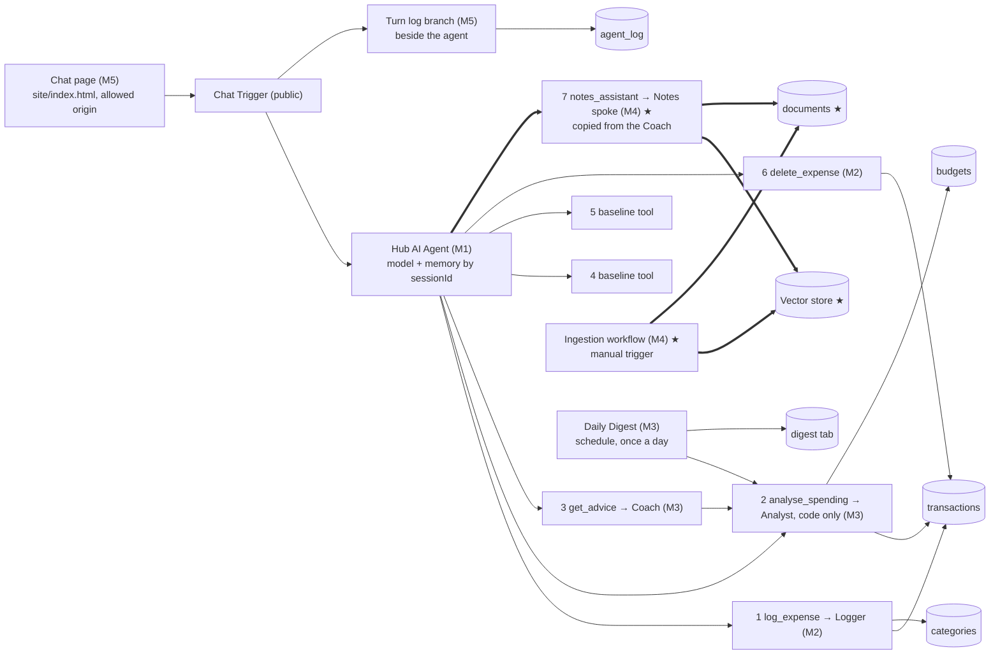

# PRD: Personal Productivity Agent with Notes and Reading Assistant (S5)

| | |
|---|---|
| **Module** | C389 AI Solution Design and Implementation, CA2 (Project 2) |
| **Scenario** | S5 Notes and Reading Assistant. Pattern: **a tool, with retrieval** |
| **Team** | Team 5 (five members, see Section 11) |
| **Repo** | https://github.com/SoeSanWaing/C389_CA2_Team5 |
| **Status** | Draft v0.1, 17 Nov 2026 |
| **Key dates** | Merged on the nominated account **before Lesson 14**. Demo, report (PDF), slides (.pptx) and final workflow JSON due 23:59 on the team's presentation day (Lesson 17 or 18) |

Related: [Member 1 PRD: Hub Agent and Merged Build](PRD-Member1-Hub-Agent.md) goes into more detail on the hub, the system message and the merge.

---

## 1. Summary

We extend the Finance Tracker baseline (built in Lessons 9 to 13) with a second area: the user's own **documents and notes**. The finished agent:

- still logs, analyses, advises on and deletes spending, exactly as the baseline did;
- stores the user's documents (notes, readings, a fee schedule) in a vector store plus a `documents` tab;
- answers questions **only from those documents**, names the document each answer came from, and says plainly when nothing matches;
- can answer a document question **beside** a spending figure in the same turn (for example, a fee schedule next to what was spent on fees).

Everything runs from one chat page that the team serves, through one hub agent with seven tools.

### One-line statements (for report 1.1)
- **Scenario:** a notes and reading assistant that answers only from the user's own stored documents and cites them.
- **Extension:** a seventh hub tool, `notes_assistant`, backed by a retrieval spoke, a vector store and a `documents` tab, sitting beside the finance tools.

---

## 2. Goals and non-goals

### Goals
| # | Goal | Measure |
|---|---|---|
| G1 | The hub picks the right tool between finance and notes | Fixed eval set and our own messages pass, with tools read from the execution |
| G2 | Notes answers are grounded | Every notes answer names a source document; nothing is answered from general knowledge |
| G3 | Clear refusal when nothing matches | The exact refusal wording appears whenever retrieval finds no match |
| G4 | Finance keeps working | Fixed eval set scores the same or better after the extension |
| G5 | Finance and notes work in one turn | The combined message calls both tools and answers both parts |
| G6 | Deployed and live | Page answers from its own origin; five failure cases recorded from the page; cold and warm times recorded |

### Non-goals
- Uploading documents through the chat. Documents are added through a separate ingestion workflow.
- Answering general-knowledge questions.
- Multi-user accounts. One user, one sheet, one vector store.
- Any document that holds other people's personal details (brief §7, Data and privacy).

---

## 3. Users and core scenarios

**User:** a polytechnic student who tracks their own spending and keeps notes, readings and a (made-up) school fee schedule.

| # | User says | Expected tool(s) | Expected result |
|---|---|---|---|
| S-1 | "Spent $4.50 on chicken rice at lunch" | `log_expense` | One checked row in `transactions` |
| S-2 | "How much have I spent on food this month?" | `analyse_spending` | Figure equal to the Analyst's output |
| S-3 | "How can I cut down on spending?" | `get_advice` | 2–3 sentences using Analyst figures only |
| S-4 | "Delete the Grab ride from yesterday" | `delete_expense` (find) | Names one entry and asks to confirm; deletes only on "yes" |
| S-5 | "What does my fee schedule say about late payment?" | `notes_assistant` (ask) | Answer plus "Source: *Fee Schedule 2026 (sample)*" |
| S-6 | "What documents do I have stored?" | `notes_assistant` (list) | List of document titles |
| S-7 | "What is the population of Japan?" | `notes_assistant` (ask) → no match | "I couldn't find that in your stored documents." |
| S-8 | "How much have I spent on school fees this month, and when is the next instalment due according to my fee schedule?" | `analyse_spending` + `notes_assistant` | Both parts answered, each with its own source |
| S-9 | "Hi!" / "Thanks" | none | Short reply, no tool |

---

## 4. Requirements

### 4.1 Functional requirements

**Baseline (must keep working)**
| ID | Requirement | Owner |
|---|---|---|
| F1 | **Hub**: one chat entry point, model, memory keyed to `sessionId`, system prompt that names every tool and forbids guessing a date or stating a number no tool returned | M1 |
| F2 | **Logger**: one sentence becomes one checked row in `transactions`, with the team's `txn_id` rule (duplicate check), or a refusal with a reason | M2 |
| F3 | **Analyst**: totals per category against budget; repeats and unreadable amounts skipped **and counted**; **no language model** | M3 |
| F4 | **Coach**: advice in 2–3 sentences, using only figures the Analyst returned | M3 |
| F5 | **delete_expense**: finds one entry, says it back, deletes only after the user confirms that entry | M2 |
| F6 | **Chat page**: hub published with a public chat trigger, widget embedded in a page we serve, allowed origin = that page's address (never `*`) | M5 |
| F7 | **Turn log**: every turn logged on a branch **beside** the agent into `agent_log` | M5 |
| F8 | **Daily digest**: one summary row a day, schedule runs **once a day** | M3 |

**S5 extension**
| ID | Requirement | Owner |
|---|---|---|
| F9 | `documents` tab in the team spreadsheet, headers in row 1 (Section 5.2) | M4 |
| F10 | Vector store holding chunked, embedded documents, each chunk tagged with its document title and id | M4 |
| F11 | Ingestion workflow: adds a document to the vector store and writes one row to `documents` | M4 |
| F12 | Notes spoke, copied from the Coach, with trigger input `action` plus `question` / `doc_title` | M4 |
| F13 | Hub tool 7, `notes_assistant`, whose description says when finance is meant instead | M1 |
| F14 | One system message rule for when to call `notes_assistant` rather than a finance tool | M1 |
| F15 | Answers name the source document; no match gives the exact refusal wording | M4 (spoke), M1 (hub rule) |
| F16 | The combined finance + notes message (S-8) works end to end from the chat page | M1, M3, M4 |
| F17 | If the fee schedule creates a new spending type, add **one row** to `categories` (for example `school fees`). Nothing else in the finance tabs changes | M2 |

### 4.2 Non-functional requirements and constraints
| ID | Constraint |
|---|---|
| N1 | **At most seven tools** on the hub |
| N2 | Analyst has **no** language model |
| N3 | Log branch sits beside the agent, never after it |
| N4 | Allowed origin is our own page's address, never `*` |
| N5 | Scheduled work runs once a day at most (shared class model quota) |
| N6 | No API key, Google credential or token in the repo, report, slides, screenshots or chat. Name credentials, never paste them |
| N7 | Own or made-up data only. Delete the data at the end of the module |
| N8 | Fixed eval prompts are never edited. Our own messages are added beside them |
| N9 | Report: CA2 template, at most 10 pages excluding appendix, repo link on page 1 |
| N10 | Lesson sheets, journal and report prose in our own words; AI for reference and exploration only |

---

## 5. Data model

One Google spreadsheet on the nominated account. **Baseline tabs keep their names and columns.** Check the baseline column lists below against your Lesson 10 sheet before building; they are a guide, not a change.

### 5.1 Baseline tabs (unchanged)
| Tab | Purpose | Owner |
|---|---|---|
| `transactions` | One row per expense, including `txn_id` | M2 |
| `categories` | Allowed categories (one new row only if S5 needs it, see F17) | M2 |
| `budgets` | Monthly budget per category | M3 |
| digest tab (baseline name) | One summary row per day | M3 |
| `agent_log` | One row per turn | M5 |

### 5.2 New tab: `documents` (for report 1.2)
| Column | What it holds | Example |
|---|---|---|
| `doc_id` | Unique id, set at ingestion | `DOC-003` |
| `title` | Title shown in citations | `Fee Schedule 2026 (sample)` |
| `doc_type` | `note`, `reading` or `fee_schedule` | `fee_schedule` |
| `source` | Where the text came from (file name or "pasted") | `fee_schedule_2026.txt` |
| `chunk_count` | Chunks written to the vector store | `6` |
| `ingested_at` | Date and time of ingestion (from the workflow, not guessed) | `2026-11-20 14:05` |
| `summary` | One-line description for `list` | `Semester fees, instalment dates, late fee` |
| `status` | `active` or `removed` | `active` |

### 5.3 Vector store
- Each chunk stores the text plus metadata `{ doc_id, title, doc_type }`, so retrieval can always name its source.
- Chunking: about 500 tokens with about 50 tokens overlap (tune during testing).
- **Decision needed (M4):** n8n's in-memory vector store is quick to set up but is **lost on restart**, so it must be re-ingested before every demo. A hosted store (for example Supabase pgvector or Pinecone free tier) keeps the data. Recommendation: hosted, if the team's credentials allow it; otherwise in-memory plus a "re-ingest" step on the demo checklist.

### 5.4 Seed documents (made-up)
| Title | Type | Used for |
|---|---|---|
| Fee Schedule 2026 (sample) | fee_schedule | Combined finance + notes message (S-8) |
| C389 Lesson Notes: Agents and Tools | note | Plain notes questions |
| Reading: Retrieval-Augmented Generation (summary) | reading | Citation across documents |
| Budgeting Tips (personal notes) | note | Tests that notes advice is not confused with the Coach |

---

## 6. Architecture (for report 2.1)

★ = S5 parts.

> Tools 4 and 5 are the remaining baseline tools from Lessons 11–12. Put their real names in before finalising the system message.

### 6.1 Workflow inventory
| Workflow | Type | Owner | Starts from |
|---|---|---|---|
| Hub | Chat trigger + AI agent | M1 | Baseline hub |
| Logger | Sub-workflow | M2 | Baseline |
| Delete Expense | Sub-workflow | M2 | Lesson 13 |
| Analyst | Sub-workflow, code only | M3 | Baseline |
| Coach | Sub-workflow | M3 | Baseline |
| Daily Digest | Schedule, once a day | M3 | Baseline |
| Turn log | Branch on the hub | M5 | Baseline |
| **Notes spoke** ★ | Sub-workflow | M4 | **Copied from the Coach** |
| **Ingestion** ★ | Manual trigger | M4 | New |

---

## 7. Component specs

### 7.1 Hub (M1)
Full spec in [PRD-Member1-Hub-Agent.md](PRD-Member1-Hub-Agent.md). In short: Tools Agent, low temperature, window memory keyed to `sessionId`, seven call-workflow tools, system message with tool list and rules (Section 8).

### 7.2 Logger and Delete Expense (M2)
- Input `{ description, amount, category, date }`. `date` comes from the date tool via the hub.
- **`txn_id` rule** (team to fix the format, for example `YYYYMMDD-amount-description-hash`). The same `txn_id` already in the sheet → `status: "duplicate"`, no new row.
- Unreadable or missing amount, or a category not in `categories` → `status: "refused"` with a reason.
- Delete: `action: "find"` returns matches only; `action: "confirm"` with one `txn_id` deletes that row only. Zero or several matches → nothing deleted.

### 7.3 Analyst, Coach, Daily Digest (M3)
- Analyst: Code node(s) only. Output `{ month, totals[{category, spent, budget, remaining}], skipped_repeats, skipped_unreadable }`.
- Coach: receives Analyst output, returns `{ advice }` in 2–3 sentences, no new numbers.
- Digest: schedule trigger once a day → Analyst → one row in the digest tab.

### 7.4 Notes spoke and ingestion (M4)
**Notes spoke** (copied from the Coach):
1. Trigger input `{ action, question?, doc_title? }`.
2. `list` → read `documents` where `status = active` → return titles and summaries.
3. `ask` → retrieve top-k chunks (k ≈ 4) from the vector store, filtered by `doc_title` if given.
4. If no chunk passes the similarity threshold → return `{ matched: false, answer: "", sources: [] }`. **No model call**, so nothing can be made up.
5. Otherwise call the model with: the chunks, their titles, and the instruction "answer only from these excerpts; if they do not contain the answer, say so". Return `{ matched: true, answer, sources: [titles] }`.

**Ingestion** (manual trigger): read text (Drive file or pasted) → split → embed → insert into the vector store with metadata → append one row to `documents`.

### 7.5 Chat page, turn log, repo (M5)
- `site/index.html` embeds the n8n chat widget pointing at the hub's public chat URL. Served from a public address (for example GitHub Pages).
- Chat trigger allowed origin = that exact address (scheme + host, no trailing path).
- Turn log: a branch off the Chat Trigger, parallel to the agent, appending `{ logged_at, session_id, user_message }` to `agent_log`.
- Repo hygiene: folder layout per README, no secrets, final JSON exported from the nominated account.

---

## 8. Agent rules (for report 1.3 and 2.3)

| Rule | Exact condition |
|---|---|
| R1 Route | Call `notes_assistant` when the user asks what a document, note, reading or fee schedule **says**. Call a finance tool when they ask what they **spent, logged or budgeted**, or want to log or delete an expense |
| R2 Both | If a message needs both, call both and answer each part with its own source |
| R3 Numbers | Never state a number no tool returned |
| R4 Dates | Never guess a date; use the date tool |
| R5 Cite or refuse | Notes answers name the source document. No match → *"I couldn't find that in your stored documents."* No general knowledge |
| R6 Confirm delete | Find first, name the one entry, wait for an explicit yes next turn. Several matches → ask which, delete nothing |
| R7 Unreadable amount | Don't log; ask for the amount |
| R8 No tool needed | Greetings, thanks and questions about this chat need no tool |
| R9 Out of scope | Say plainly it can't be done and list what the assistant can do |

The draft system message and the `notes_assistant` tool description are in the Member 1 PRD, Section 5. The report pastes the **final** text from the build, word for word.

---

## 9. Evaluation plan (for report section 3)

### 9.1 Method
1. Write the expected tool(s) for every message **before** sending it, in `eval/expected.md`.
2. **Before run:** merged finance build, tool 7 not connected. Run the fixed eval set from Lesson 13.
3. **After run:** tool 7 connected. Run the fixed eval set again, plus our own S5 messages.
4. Read the tools from the **execution**, not the reply. Screenshot each execution.
5. Each failure is labelled **prompt**, **tool** or **data**, with its cause.
6. After any prompt change, rerun the whole set, not just the failing message.

### 9.2 Our own messages (3–5, added beside the fixed set)
| ID | Message | Expected tools |
|---|---|---|
| E1 | "What does my fee schedule say about the late payment fee?" | `notes_assistant` |
| E2 | "Who won the 2022 World Cup?" | `notes_assistant` → no match, refusal |
| E3 | S-8 combined message | `analyse_spending` + `notes_assistant` |
| E4 | "What did my budgeting notes say about food spending?" | `notes_assistant` only (not `get_advice`) |
| E5 | "Log $350 for school fees" | `log_expense` only (not `notes_assistant`) |

E4 and E5 are deliberately confusing, to test the routing rule.

### 9.3 Before vs after measures (report 3.3)
| Measure | Before | After | Out of |
|---|---|---|---|
| Fixed eval set passed | | | |
| Messages that called a tool when none was needed | | | |
| Extension messages passed | — | | 5 |

### 9.4 Five failure cases, run from the page (report 4.2)
| Case | How we run it |
|---|---|
| Normal question | Send S-2 from the page |
| Workflow switched off | Deactivate the hub, send S-2, record the widget's error, reactivate |
| Origin not allowed | Open the same page from another address (for example `localhost`), send a message |
| Tool the agent doesn't have | "Book me a flight to Bangkok" |
| Empty message | Send an empty or whitespace message |

### 9.5 Response times (report 4.3)
- **Cold:** first message after at least 10 minutes idle.
- **Warm:** the next message straight after.
- Measure: stopwatch from send to first reply, plus the execution duration in n8n. Three tries each, report the median.

---

## 10. Acceptance criteria (definition of done)

The build is done when, on the nominated account and from the chat page:
- [ ] All seven tools connected; hub shows exactly 7 tools
- [ ] S-1 to S-9 behave as in Section 3, read from the executions
- [ ] Combined message S-8 calls both tools in one execution
- [ ] `documents` tab has headers in row 1 and one row per ingested document
- [ ] Vector store holds the seed documents (re-ingested on demo day if in-memory)
- [ ] Turn log writes one row per turn; digest writes one row a day
- [ ] Allowed origin = page address; five failure cases recorded
- [ ] Before and after eval runs recorded in `eval/`
- [ ] Final workflow JSON exported from the nominated account in `workflows/final/`, no secrets
- [ ] Site files in `site/`

---

## 11. Team, ownership and deliverables

| Member | Build | Report sections | Presentation |
|---|---|---|---|
| 1 | Hub: session memory, 7-tool wiring, system message routing, merge of all workflows | 1.3, 2.1, 2.3 | Intro, architecture, wrap-up |
| 2 | Logger (`txn_id` duplicate check), Delete Expense; `transactions`, `categories` | 2.2 (their rows), 2.5 (their part) | Demo: logging and deleting |
| 3 | Analyst (code only), Coach, Daily Digest; `budgets` | 2.2 (their rows), 3.3 | Demo: Analyst, Coach, digest |
| 4 | Vector store, embeddings, `documents` tab, ingestion, citation and refusal | 1.1, 1.2, 1.4 | Demo: cited answers and refusals |
| 5 | Chat page, CORS origin, turn log, `agent_log`, repo hygiene | 4.1, 4.2, 4.3 | Live deployment demo |

Sections not yet assigned: **2.4** (combined message evidence), **3.1, 3.2, 3.4, 3.5** (eval method, results, failure analysis, limits) and **5** (contributions). Suggest: 2.4 → M1; 3.1/3.2 → M3 with M5; 3.4/3.5 → whole team review; 5 → each member writes their own row.

### 11.1 Interface contracts
| Spoke | Input | Output |
|---|---|---|
| Logger | `{ description, amount, category, date }` | `{ status, txn_id, reason }` |
| Analyst | `{ month, category? }` | `{ month, totals[], skipped_repeats, skipped_unreadable }` |
| Coach | `{ question }` | `{ advice }` |
| Delete Expense | `{ action, query?, txn_id? }` | `{ matches[] }` or `{ deleted, txn_id }` |
| Notes | `{ action, question?, doc_title? }` | `{ matched, answer, sources[] }` or `{ documents[] }` |

Any change to a contract is agreed in the group chat **before** it is built.

### 11.2 Presentation plan (30 minutes including questions)
| Min | Segment | Who |
|---|---|---|
| 0–4 | Intro: problem, S5, architecture | M1 |
| 4–8 | Logging, duplicate refusal, delete with confirm | M2 |
| 8–12 | Analyst, Coach, digest row | M3 |
| 12–17 | Cited answers, refusal, combined message | M4 |
| 17–22 | Live page, five failure cases, cold vs warm | M5 |
| 22–24 | Eval before vs after, what we cut, wrap-up | M1 |
| 24–30 | Questions (anyone may be asked about any part) | All |

Demo rules: page already open and warmed up, say up front that the first turn is slow, show at least one refusal, backup recording ready.

---

## 12. Timeline

| When | Milestone | Who |
|---|---|---|
| This week | Contracts agreed; nominated account chosen; repo skeleton merged | All |
| Lesson 13 | Each spoke works alone with test input; `documents` tab and seed docs ready; delete-with-confirm done | All |
| **Before Lesson 14** | **Everything merged on the nominated account**; "before" eval run recorded | M1 + all |
| Lesson 14 (clinic) | Notes spoke connected as tool 7; S-8 working from the page | M1, M4 |
| Term break, week 1 | "After" eval run; failure analysis; prompt tuning; five failure cases and latency recorded | M1, M3, M5 |
| Term break, week 2 | Build frozen; final JSON exported to repo; report draft complete | All |
| 3 days before demo | Slides done; full rehearsal with the page open; backup recording made | All |
| Lesson 17/18 | Present; submit report PDF + .pptx on SA3.0; repo final by 23:59 | All |

---

## 13. Risks

| Risk | Impact | Mitigation |
|---|---|---|
| Hub confuses notes and finance questions | Eval failures | Sharp routing rule, tool description that names when finance is meant, confusing cases in our eval set |
| Notes answer drifts into general knowledge | Breaks S5's main rule | Similarity threshold in the spoke; skip the model call when nothing matches; exact refusal wording |
| In-memory vector store lost on restart | Empty answers at the demo | Use a hosted store, or re-ingest on the demo-day checklist |
| Merge breaks sub-workflow links or credentials | Hub tools fail | Merge before Lesson 14 and follow the checklist in the Member 1 PRD |
| Shared model quota runs out | Slow or failed demo | Digest once a day only; no test loops; backup recording |
| Nominated account owner absent | No demo | Choose the most reliable attendee; a second member can edit the sheet |
| Secrets leak into JSON or screenshots | Rule breach | Search exports for keys before every push; crop screenshots |
| Finance breaks after extension | Lose baseline marks | Before/after runs of the fixed eval set; fix before adding more |

---

## 14. Open questions

1. Real names of baseline tools 4 and 5.
2. Nominated account: which member?
3. `txn_id` format (M2).
4. Vector store: hosted or in-memory (M4)?
5. Does the fee schedule add a spending category such as `school fees` (F17)?
6. Where the page is hosted (GitHub Pages or other) and its exact address, for the allowed origin (M5).
7. Owners for the unassigned report sections (2.4, 3.1, 3.2, 3.4, 3.5, 5).
